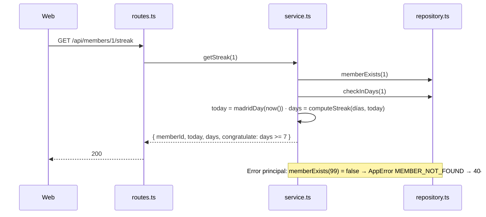

# HU-01: Ver mi racha de asistencia · Diseño técnico (backend)

- **Origen:** `specs/PRD.md` (estado Ready, 2026-11-16)
- **Generado por:** backend-architect
- **Scope cubierto:** RF-01, RF-02 · RNF-01, RNF-02, RNF-04
- **Firma 3 (developers):** aprobado por el responsable técnico, 2026-11-16

## Enfoque técnico
La racha no se guarda: se calcula al consultarla. Una función pura, `computeStreak(checkInDays, today)`, recibe los
días con check-in (texto `AAAA-MM-DD`) y "hoy" en Madrid, y cuenta hacia atrás. El servicio pide "hoy" al reloj
inyectado (DEC-07), lee los días del socio con una consulta parametrizada y decide la felicitación (`days >= 7`).

## Módulos y ficheros afectados

| Módulo | Fichero | Cambio |
|---|---|---|
| attendance | `apps/api/src/modules/attendance/streak.ts` | nuevo: `computeStreak`, `CONGRATULATE_FROM_DAYS` |
| attendance | `apps/api/src/modules/attendance/repository.ts` | modificar: `checkInDays(memberId)` |
| attendance | `apps/api/src/modules/attendance/service.ts` | modificar: `getStreak(memberId)` |
| attendance | `apps/api/src/modules/attendance/schemas.ts` | modificar: `streakResponseSchema` |
| attendance | `apps/api/src/modules/attendance/routes.ts` | modificar: `GET /:id/streak` |

## Contrato de API

`GET /api/members/:id/streak`, sin cuerpo.

- `params`: `idParamsSchema` (`id` texto `^[1-9][0-9]{0,14}$`).
- **200** `{ memberId: integer, today: string (AAAA-MM-DD), days: integer ≥ 0, congratulate: boolean }`, con
  `additionalProperties: false` en el schema de respuesta (RNF-04: ni nombre ni lista de días).
- **400** `VALIDATION_ERROR` con `details: [{ field: 'id', … }]` · **404** `MEMBER_NOT_FOUND` · **500**
  `INTERNAL_ERROR` (envelope de DEC-06).

## Migración de datos
N/A: no hay migración. Se lee `check_ins` de `001-create-members-and-check-ins.sql`, con su índice `(member_id, day)`.

## Diagrama de secuencia

## Error paths

| Edge case (PRD) | Dónde se detecta | Estrategia | Respuesta o efecto observable | Test |
|---|---|---|---|---|
| EC-01 | `computeStreak` | si hoy no hay check-in, empieza en ayer | la racha cuenta desde ayer | `apps/api/test/attendance/streak.test.ts` |
| EC-02 | `madridDay` (DEC-07) | día de Madrid con el reloj inyectado | 23:59:59 y 00:00:00 son días distintos, invierno y verano | `apps/api/test/attendance/streak-adversarial.test.ts` |
| EC-03 | `computeStreak` | los días van a un `Set` | duplicados cuentan uno | `apps/api/test/attendance/streak.test.ts` |
| EC-04 | servicio | `memberExists` antes de leer | 404 `MEMBER_NOT_FOUND` | `apps/api/test/attendance/streak-api.test.ts` |
| EC-05 | servicio | solo lectura | misma respuesta, sin escrituras | `apps/api/test/attendance/streak-api.test.ts` |
| EC-06 | frontend | - | ver TECHNICAL_DOC-frontend | - |
| EC-07 | servicio | `days >= CONGRATULATE_FROM_DAYS` | 6 → `false`; 7 → `true` | `apps/api/test/attendance/streak-api.test.ts` |
| EC-08 | frontend | - | ver TECHNICAL_DOC-frontend | - |
| EC-09 | check-in de T-01 | no duplica dentro de la transacción | cuentan uno | `apps/api/test/attendance/checkins.test.ts` |
| EC-10 | JSON Schema de `params` | rechazar | 400 `VALIDATION_ERROR`; nunca llega al SQL | `apps/api/test/attendance/streak-adversarial.test.ts` |
| EC-11 | manejador de errores | 500 genérico | `INTERNAL_ERROR` sin datos del socio | `apps/api/test/attendance/streak-adversarial.test.ts` |
| EC-12 | frontend | - | ver TECHNICAL_DOC-frontend | - |

## Threat modeling

| STRIDE | Amenaza | Mitigación | Riesgo residual |
|---|---|---|---|
| Information disclosure | La respuesta expone la lista de días o el nombre | Schema de respuesta con 4 campos y `additionalProperties: false` | Bajo |
| Information disclosure | Enumerar socios por `:id` | Sin login (DEC-04): cualquiera ve la racha de un `id`; solo un número, sin nombre | Aceptado (DEC-04) |
| Tampering | Inyección SQL por `:id` | `pattern` en `params` y sentencias preparadas | Bajo |
| Denial of service | Un socio con muchos check-ins | Cálculo lineal sobre días distintos; CA-06 lo mide con 400 | Bajo |

## Datos personales
Lee los días con check-in del socio para calcular su racha (RGPD §1 y §3). La respuesta no devuelve el nombre ni los
días; nada en logs (el serializador quita la query) ni en mensajes de error.

## Decisiones de diseño

### DD-01: cálculo puro con "hoy" como parámetro
- **Decisión:** `computeStreak(checkInDays, today)` en `streak.ts`, sin reloj ni base de datos.
- **Alternativa descartada:** una consulta SQL recursiva que cuente los días seguidos: más difícil de leer y de probar
  en las fronteras del día.
- **Motivo:** las fronteras (medianoche de Madrid, cambio de hora) se prueban sin trucos de reloj.

### DD-02: la felicitación la decide la API
- **Decisión:** `congratulate = days >= CONGRATULATE_FROM_DAYS` (7) en el servicio (DT-01 del PRD).
- **Alternativa descartada:** que la web compare con 7: la regla quedaría repartida.

## Impacto en decisiones
Respeta DEC-04, DEC-06, DEC-07 y DEC-08. No propone decisiones nuevas.

## Estrategia de tests
- **Vitest puro** (`streak.test.ts`): CA-01, CA-02, CA-03, EC-01, EC-03.
- **Vitest con `app.inject`** sobre `:memory:` y `createTestClock`: CA-04 (6 y 7 días), EC-04, EC-05, CA-06 (400
  check-ins en menos de 300 ms).
- **Adversarial** (`streak-adversarial.test.ts`): EC-02 en invierno y verano, EC-10, EC-11 con `failWrites`/un fallo
  de lectura.
- **Playwright**: el recorrido completo, en la task de e2e (ver frontend).

## Riesgos

| Riesgo | Probabilidad (1–5) | Impacto (1–5) | Mitigación |
|---|---|---|---|
| Contar en días de UTC | 2 | 4 | `madridDay` y pruebas de frontera (EC-02) |

## Open Decisions
No hay.

## Fuera de scope
Guardar la racha, historial y récord.
