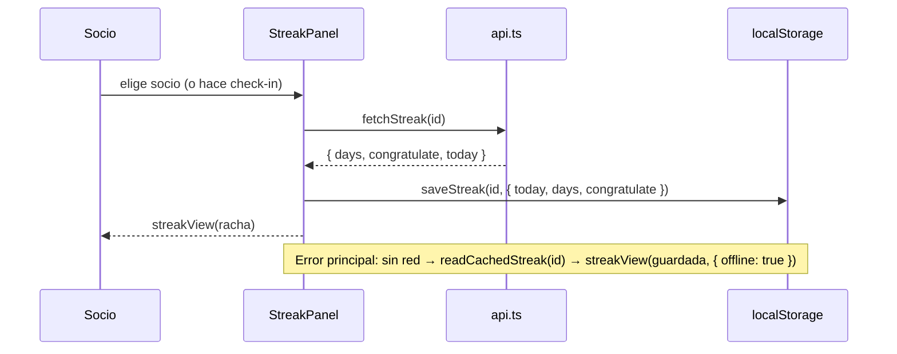

# HU-01: Ver mi racha de asistencia · Diseño técnico (frontend)

- **Origen:** `specs/PRD.md` (estado Ready, 2026-11-16)
- **Generado por:** frontend-architect
- **Scope cubierto:** RF-03, RF-04 · RNF-03, RNF-04
- **Firma 3 (developers):** aprobado por el responsable técnico, 2026-11-16

## Enfoque técnico
Un panel de racha (`StreakPanel`) dentro de la pantalla "Tu asistencia" de T-02. Carga
`GET /api/members/:id/streak` al elegir socio y tras cada check-in. Una función pura, `streakView`, convierte la racha
(o su ausencia) en lo que se pinta, para probar cada estado sin DOM. Si la API no responde, el panel pinta la última
racha guardada en `localStorage` con el aviso.

## Módulos y ficheros afectados

| Módulo | Fichero | Cambio |
|---|---|---|
| attendance | `apps/web/src/features/attendance/streak-view.ts` | nuevo: `streakView` y textos |
| attendance | `apps/web/src/features/attendance/StreakPanel.tsx` | nuevo |
| attendance | `apps/web/src/features/attendance/streak-cache.ts` | nuevo: leer y guardar la última racha |
| attendance | `apps/web/src/features/attendance/api.ts` | modificar: `fetchStreak` |
| attendance | `apps/web/src/features/attendance/types.ts` | modificar: `Streak` |
| attendance | `apps/web/src/features/attendance/AttendanceScreen.tsx` | modificar: compone el panel y lo refresca tras el check-in |

## Pantallas y estados

Pantalla "Tu asistencia", panel `.card` con `role="status"` (RNF-03):

| Estado | Qué se ve |
|---|---|
| Cargando | "Cargando tu racha…" |
| Vacío (0 días) | "0", "días seguidos" y "Empieza tu racha hoy" (CA-03) |
| Con racha | El número grande y "día seguido" o "días seguidos"; 120 cabe (EC-06) |
| Felicitación (`congratulate`) | Además: "¡Enhorabuena! Ya llevas una semana o más sin fallar." (CA-04) |
| Sin conexión, con algo guardado | La última racha con "Sin conexión: esta es tu última racha guardada." (CA-05) |
| Sin conexión, sin nada guardado | Solo "Sin conexión y sin ninguna racha guardada todavía." (EC-08) |
| Error de la API (404, forma inesperada) | `ErrorMessage` con reintento (EC-12) |

## Migración de datos
N/A: no hay migración.

## Diagrama de secuencia

## Error paths

| Edge case (PRD) | Dónde se detecta | Estrategia | Respuesta o efecto observable | Test |
|---|---|---|---|---|
| EC-01 a EC-05, EC-07, EC-09 a EC-11 | API | ver TECHNICAL_DOC-backend | - | - |
| EC-06 | `streakView` | el número es texto; CSS de 4rem en una columna de 32rem | "120" cabe y se lee | `apps/web/test/features/attendance/streak-view.test.ts` |
| EC-07 | `streakView` | muestra el mensaje solo si `congratulate` | 6 sin mensaje; 7 con él | `apps/web/test/features/attendance/streak-view.test.ts` |
| EC-08 | `StreakPanel` | `isOffline(error)` y caché vacía | solo el aviso, sin número | `apps/web/test/features/attendance/StreakPanel.test.tsx` |
| EC-12 | `api.ts` | valida la forma y lanza `badResponse()` | `ErrorMessage` con reintento | `apps/web/test/features/attendance/StreakPanel.test.tsx` |

## Threat modeling

| STRIDE | Amenaza | Mitigación | Riesgo residual |
|---|---|---|---|
| Information disclosure | `localStorage` con datos de más | Solo `{ today, days, congratulate }` por `id` (RGPD §6) | Bajo |
| Tampering | Un valor guardado manipulado | Se valida la forma al leer; si no vale, se ignora | Bajo |
| Spoofing/XSS | Pintar HTML de la API | React escapa; nunca `dangerouslySetInnerHTML` | Bajo |

## Datos personales
Muestra la racha del socio elegido. Guarda en el navegador solo la última racha y su día (`gymapp:streak:<id>`), nunca
el nombre ni los días (RGPD §6). Nada en `console`.

## Decisiones de diseño

### DD-03: vista pura de la racha
- **Decisión:** `streakView(streak | null, { offline })` devuelve número, etiqueta, mensaje y aviso.
- **Alternativa descartada:** condicionales dentro del JSX: cada estado exigiría montar el componente para probarlo.

### DD-04: caché mínima con `try/catch`
- **Decisión:** `streak-cache.ts` lee y escribe con `try/catch` (modo privado o almacenamiento lleno no rompen nada) y
  valida la forma al leer.
- **Alternativa descartada:** guardar la respuesta entera: incluiría `memberId` y lo que la API añada en el futuro.

## Impacto en decisiones
Respeta DEC-06 (`isOffline` distingue la red del resto) y DEC-07 (la web no calcula "hoy"). Usa `localStorage`, que
RGPD §6 permite solo para la última racha.

## Estrategia de tests
- **Vitest** (`streak-view.test.ts`): CA-03, CA-04, EC-06, EC-07.
- **Testing Library** (`StreakPanel.test.tsx`): carga, refresco tras check-in, CA-05, EC-08, EC-12.
- **Playwright** (`e2e/streak.spec.ts`): Irene hace check-in y ve 7 días con la felicitación; Pau ve 120.

## Riesgos

| Riesgo | Probabilidad (1–5) | Impacto (1–5) | Mitigación |
|---|---|---|---|
| Mostrar la racha de otro socio tras cambiar rápido | 2 | 3 | `AbortController` por carga y `key` por socio |

## Open Decisions
No hay.

## Fuera de scope
Check-in sin conexión, historial y récord.
