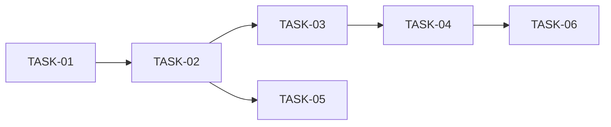

# HU-01: Ver mi racha de asistencia · Roadmap de tareas

## Resumen
- **Fuente de verdad:** los TECHNICAL_DOC de `plans/` (no el PRD).
- **Tareas:** 6 (S: 4 · M: 2) · estimación total: 5 h
- **Cobertura:** cada RF del PRD → task(s); cada edge case → task con su test.

## Fases

| Fase | Tareas | Objetivo |
|---|---|---|
| 1 | TASK-01, TASK-02 | La racha en la API |
| 2 | TASK-03, TASK-04 | La racha en la web, también sin conexión |
| 3 | TASK-05, TASK-06 | Romperla a propósito y recorrerla en el navegador |

## Dependencias

## Orden de implementación
TASK-01 → TASK-02 → TASK-03 → TASK-04 → TASK-05 → TASK-06. TASK-05 podría ir en paralelo con TASK-03 (no comparten ficheros); se hace en serie para que cada commit deje la integración en verde.

## Cobertura PRD → tareas

| RF / CA / EC | Task(s) |
|---|---|
| RF-01 · CA-01, CA-02, CA-03 | TASK-01 |
| RF-02 · CA-04, CA-06 | TASK-02 |
| RF-03 · CA-03, CA-04 | TASK-03 |
| RF-04 · CA-05 | TASK-04 |
| EC-01, EC-03 | TASK-01, TASK-05 |
| EC-02, EC-10, EC-11 | TASK-05 |
| EC-04, EC-05, EC-07 | TASK-02 |
| EC-06 | TASK-03, TASK-06 |
| EC-08 | TASK-04 |
| EC-09 | T-01 (sprint-01, ya en `main`) |
| EC-12 | TASK-03 |

## Riesgos
- El corte del día en UTC: lo cubren TASK-05 y el reloj inyectado.
