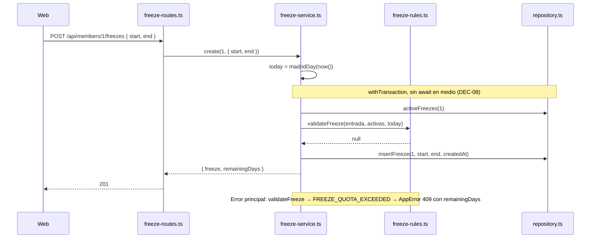
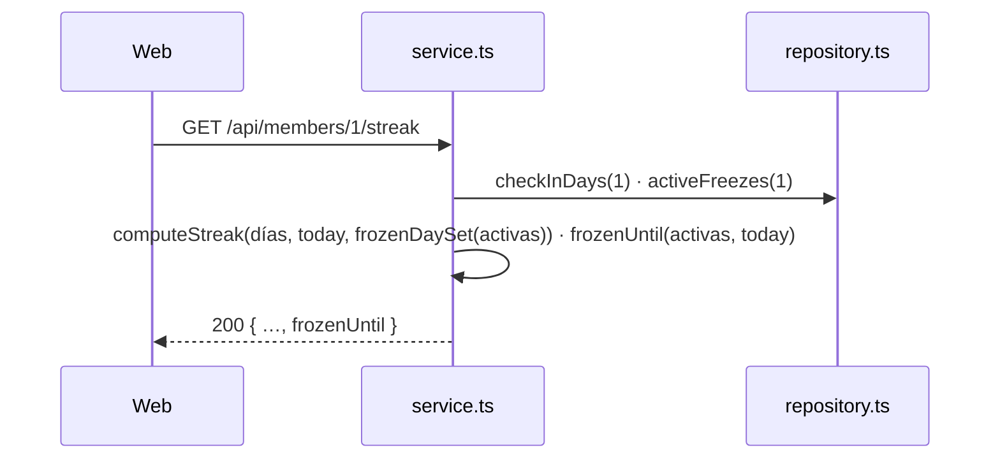

# HU-02: Congelar mi racha · Diseño técnico (backend)

- **Origen:** `specs/PRD.md` (estado Ready, 2026-11-18)
- **Generado por:** backend-architect
- **Scope cubierto:** RF-01, RF-02, RF-03 · RNF-01, RNF-02, RNF-04
- **Firma 3 (developers):** aprobado por el responsable técnico, 2026-11-18

## Enfoque técnico
Las reglas de la congelación son **funciones puras** con "hoy" como dato (`freeze-rules.ts`): validar una congelación
nueva contra las activas del socio, calcular el cupo por año, decidir si se puede cancelar, el conjunto de días
congelados y `frozenUntil`. El servicio de congelaciones (`freeze-service.ts`) lee, valida con esas reglas y escribe
**dentro de `withTransaction` y sin `await` en medio** (DEC-08), y las rutas solo traducen sus errores a HTTP.
`computeStreak` recibe además los días congelados y los salta.

## Módulos y ficheros afectados

| Módulo | Fichero | Cambio |
|---|---|---|
| attendance | `apps/api/src/db/migrations/002-create-freezes.sql` | nuevo |
| attendance | `apps/api/src/modules/attendance/freeze-rules.ts` | nuevo: reglas puras |
| attendance | `apps/api/src/modules/attendance/freeze-service.ts` | nuevo: crear, listar y cancelar |
| attendance | `apps/api/src/modules/attendance/freeze-routes.ts` | nuevo: las 3 rutas |
| attendance | `apps/api/src/modules/attendance/repository.ts` | modificar: lecturas y escrituras de `freezes` |
| attendance | `apps/api/src/modules/attendance/schemas.ts` | modificar: cuerpo y respuestas; `frozenUntil` en la racha |
| attendance | `apps/api/src/modules/attendance/streak.ts` | modificar: `computeStreak(días, hoy, congelados)` |
| attendance | `apps/api/src/modules/attendance/service.ts` | modificar: la racha con congelaciones y `frozenUntil` |
| transversal | `apps/api/src/app.ts` | modificar: registra las rutas de congelación |

## Contrato de API

Todas bajo `/api/members/:id` (`idParamsSchema`); 404 `MEMBER_NOT_FOUND` si el socio no existe. Una congelación se
devuelve como `{ id, start, end, createdAt, cancelledAt }` (sin `memberId` ni nombre).

| Método y ruta | Entrada | Éxito | Errores |
|---|---|---|---|
| `POST /freezes` | `{ start, end }`: textos, obligatorios, `maxLength` 10, `additionalProperties: false` | 201 `{ freeze, remainingDays }` (cupo del año del inicio) | 400 `VALIDATION_ERROR` con `details[].field` `start`/`end`/`body` · 409 `FREEZE_QUOTA_EXCEEDED` con `remainingDays` · 409 `FREEZE_OVERLAP` |
| `GET /freezes` | - | 200 `{ today, remainingDays, freezes }`: activas por inicio; cupo del año de hoy | - |
| `DELETE /freezes/:freezeId` | `freezeId` con `pattern` | 200 `{ freeze, remainingDays }` | 409 `FREEZE_ALREADY_STARTED` · 409 `FREEZE_ALREADY_CANCELLED` · 404 `FREEZE_NOT_FOUND` (también si es de otro socio) |
| `GET /streak` | - | 200 `{ memberId, today, days, congratulate, frozenUntil }` (`frozenUntil`: fin de la congelación activa que contiene hoy, o `null`) | - |

Mensajes (castellano, sin repetir el valor recibido): "La fecha de inicio no es un día válido (AAAA-MM-DD).", "No se
puede congelar hacia atrás: el inicio tiene que ser hoy o después.", "La fecha de fin no puede ser anterior a la de
inicio.", "Solo te quedan N días para congelar en AAAA.", "Ya tienes una congelación que coincide con esos días.",
"Esta congelación ya ha empezado y no se puede cancelar.", "Esta congelación ya estaba cancelada.", "No existe esa
congelación.".

## Migración de datos
`apps/api/src/db/migrations/002-create-freezes.sql`: tabla `freezes` (`id`, `member_id` FK, `start_day`, `end_day`
con `CHECK (end_day >= start_day)` y formato `AAAA-MM-DD`, `created_at`, `cancelled_at` nulo) e índice
`(member_id, start_day)`. No toca datos existentes: los socios empiezan sin congelaciones (EC-09). Sin columna de motivo
(RNF-04). El seed no crea congelaciones.

## Diagrama de secuencia

## Error paths

| Edge case (PRD) | Dónde se detecta | Estrategia | Respuesta o efecto observable | Test |
|---|---|---|---|---|
| EC-01 | schema (tipo, ausente) y `validateFreeze` (día que no existe, formato) | rechazar | 400 `VALIDATION_ERROR`, `details[].field` | `apps/api/test/attendance/freeze-rules.test.ts`, `freeze-api.test.ts` |
| EC-02 | `validateFreeze` | comparar con `today` de Madrid | hoy 201; ayer 400 en `start` | `freeze-rules.test.ts`, `freeze-api.test.ts` |
| EC-03 | `validateFreeze` (cupo por año) | rechazar | 7 → 201; 8 → 409 `FREEZE_QUOTA_EXCEEDED` + `remainingDays` | `freeze-rules.test.ts`, `freeze-api.test.ts` |
| EC-04 | `validateFreeze` | cada día en su año | 30/12-02/01 cuenta 2 y 2 | `freeze-rules.test.ts` |
| EC-05 | transacción | leer-validar-escribir sin `await` | la segunda, 409 `FREEZE_OVERLAP` | `freeze-adversarial.test.ts` |
| EC-06 | `withTransaction` | `ROLLBACK` | 500 `INTERNAL_ERROR`, 0 filas | `freeze-adversarial.test.ts` |
| EC-07 | `frozenUntil` | solo si `start <= today <= end` | `null` si empieza mañana | `streak-freeze.test.ts` |
| EC-08 | `computeStreak` | solo salta días congelados | el hueco rompe | `streak-freeze.test.ts` |
| EC-09 | `computeStreak` sin congelados | igual que v1 | misma racha | `streak-freeze.test.ts` y los tests de HU-01 |
| EC-10 | `activeFreezes` | filtra `cancelled_at IS NULL` | no se salta | `streak-freeze.test.ts` |
| EC-11 | `checkCancel` | rechazar | 409 `FREEZE_ALREADY_CANCELLED` | `freeze-cancel.test.ts` |
| EC-12 | `findFreeze(memberId, id)` | buscar por socio y id | 404 `FREEZE_NOT_FOUND` | `freeze-cancel.test.ts` |
| EC-13 | frontend | - | ver TECHNICAL_DOC-frontend | - |
| EC-14 | schema `additionalProperties: false` | rechazar | 400, nada guardado | `freeze-adversarial.test.ts` |
| EC-15 | manejador de errores (JSON no válido) y schema (`type: object`) | rechazar | 400 `VALIDATION_ERROR` | `freeze-adversarial.test.ts` |
| EC-16 | frontend (botón) y `validateFreeze` (solape) | deshabilitar · rechazar | la segunda, 409 | `freeze-api.test.ts` |

## Threat modeling

| STRIDE | Amenaza | Mitigación | Riesgo residual |
|---|---|---|---|
| Tampering | Cancelar o ver la congelación de otro socio | `findFreeze(memberId, freezeId)` exige los dos | Bajo |
| Tampering | Saltarse el cupo con dos peticiones a la vez | Transacción síncrona (DEC-08) | Bajo |
| Information disclosure | Guardar el motivo (datos de salud) en un campo libre | `additionalProperties: false`; sin columna | Bajo |
| Tampering | Inyección por `:freezeId` | `pattern` y SQL parametrizado | Bajo |
| Denial of service | Rangos enormes (`2026-01-01`→`2099-12-31`) | El cupo corta en 7 días antes de recorrer más | Bajo |

## Datos personales
Escribe y lee inicio, fin, alta y cancelación de las congelaciones del socio (RGPD §1). Ninguna respuesta lleva el
nombre ni `memberId` en la congelación; ningún mensaje repite las fechas recibidas; nada en logs. **Nunca el motivo**
(RGPD §2): ni columna ni campo en el cuerpo.

## Decisiones de diseño

### DD-01: los días congelados entran en el cálculo como un conjunto
- **Decisión:** `computeStreak(checkInDays, today, frozenDays: Set)` salta los días del conjunto sin check-in.
- **Alternativa descartada:** guardar la racha y "pausarla": obliga a mantener un estado que hoy se calcula.

### DD-02: reglas puras en `freeze-rules.ts`
- **Decisión:** `validateFreeze` y `checkCancel` devuelven un error de dominio o `null`; el servicio lo convierte en
  `AppError`.
- **Alternativa descartada:** validar en las rutas: las fronteras (hoy, cupo, cruce de año) se probarían por HTTP.

### DD-03: cancelar marca, no borra
- **Decisión:** `cancelled_at` (DT-02 del PRD).
- **Alternativa descartada:** `DELETE` físico: se pierde el rastro de que existió.

### DD-04: el cupo se valida dentro de la transacción
- **Decisión:** `activeFreezes` + `validateFreeze` + `insertFreeze` dentro de `withTransaction`, sin `await`.
- **Alternativa descartada:** un `UNIQUE` en la base: no puede expresar ni el solape de rangos ni el cupo anual.

## Impacto en decisiones
Respeta DEC-04, DEC-06 (`remainingDays` como campo extra del envelope), DEC-07 y DEC-08. No propone decisiones nuevas.

## Estrategia de tests
- **Vitest puro:** `freeze-rules.test.ts` (CA-01 a CA-04, EC-01 a EC-04), `streak-freeze.test.ts` (CA-05, CA-06,
  CA-10, EC-07 a EC-10).
- **Vitest con `app.inject`:** `freeze-api.test.ts` (crear y listar), `freeze-cancel.test.ts` (CA-07, CA-08, EC-11,
  EC-12) y la racha con `frozenUntil`.
- **Adversarial:** `freeze-adversarial.test.ts` (EC-05, EC-06, EC-14, EC-15, RNF-01, RNF-02).
- **Playwright:** ver TECHNICAL_DOC-frontend.

## Riesgos

| Riesgo | Probabilidad (1–5) | Impacto (1–5) | Mitigación |
|---|---|---|---|
| Un test de HU-01 que compara la respuesta entera de la racha rompe al añadir `frozenUntil` | 4 | 1 | Se actualiza en TASK-03, dicho en el brief |

## Open Decisions
No hay.

## Fuera de scope
Motivo, aprobación, avisos, editar una congelación y cupos por tipo de abono.
