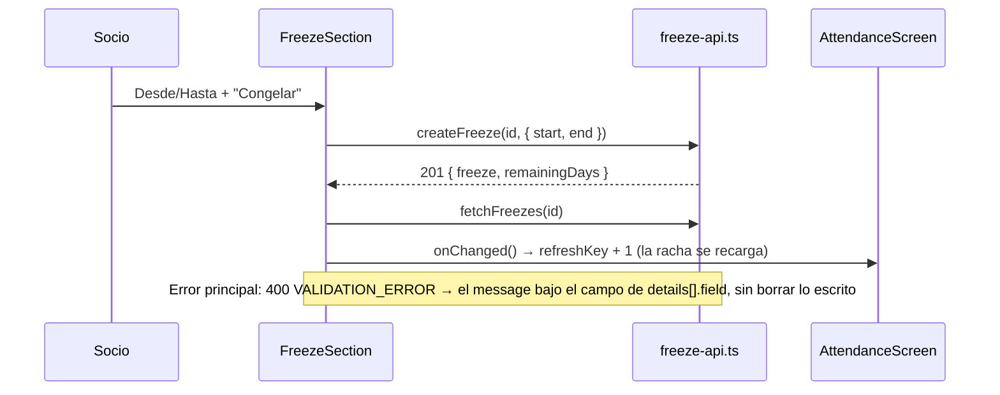

# HU-02: Congelar mi racha · Diseño técnico (frontend)

- **Origen:** `specs/PRD.md` (estado Ready, 2026-11-18)
- **Generado por:** frontend-architect
- **Scope cubierto:** RF-04 · RNF-03, RNF-04
- **Firma 3 (developers):** aprobado por el responsable técnico, 2026-11-18

## Enfoque técnico
En "Tu asistencia", el panel de la racha muestra además "Racha congelada hasta el dd/mm/aaaa" si la API devuelve
`frozenUntil`. Debajo, una sección "Congelar mi racha" (`FreezeSection`, contenedor) carga
`GET /api/members/:id/freezes` y compone un formulario (`FreezeForm`) y una lista (`FreezeList`). Tras congelar o
cancelar, recarga la lista y pide a la pantalla que refresque la racha (mismo `refreshKey` que el check-in).

## Módulos y ficheros afectados

| Módulo | Fichero | Cambio |
|---|---|---|
| attendance | `apps/web/src/features/attendance/freeze-api.ts` | nuevo: listar, crear y cancelar |
| attendance | `apps/web/src/features/attendance/FreezeSection.tsx` | nuevo: contenedor |
| attendance | `apps/web/src/features/attendance/FreezeForm.tsx` | nuevo: formulario con errores por campo |
| attendance | `apps/web/src/features/attendance/FreezeList.tsx` | nuevo: lista con "Cancelar" |
| attendance | `apps/web/src/features/attendance/types.ts` | modificar: `Freeze`, `FreezeList`, `frozenUntil` |
| attendance | `apps/web/src/features/attendance/api.ts` | modificar: `frozenUntil` en la racha |
| attendance | `apps/web/src/features/attendance/streak-view.ts` | modificar: texto de congelada |
| attendance | `apps/web/src/features/attendance/StreakPanel.tsx` | modificar: pinta el aviso |
| attendance | `apps/web/src/features/attendance/AttendanceScreen.tsx` | modificar: compone `FreezeSection` |

## Pantallas y estados

Sección "Congelar mi racha" (`<section aria-labelledby>` con su `h2`):

| Estado | Qué se ve |
|---|---|
| Cargando | "Cargando tus congelaciones…" |
| Error al cargar | `ErrorMessage` con reintento |
| Sin congelaciones | "Te quedan 7 días para congelar este año." y "No tienes ninguna congelación." |
| Con congelaciones | Lista "del dd/mm/aaaa al dd/mm/aaaa", con "Cancelar" solo si empieza después de hoy (RN-07) |
| Enviando | "Congelar" deshabilitado (EC-16) |
| Error de un campo (400) | El `message` bajo "Desde" o "Hasta" con `role="alert"` y `aria-describedby`; lo escrito se conserva (RNF-03) |
| Sin cupo o solape (409) | El `message` de la API bajo el formulario, con `role="alert"` |
| Sin conexión (EC-13) | "Sin conexión: no se ha podido congelar. Inténtalo de nuevo."; lo escrito se conserva |
| Hecho | "Racha congelada del dd/mm/aaaa al dd/mm/aaaa." con `role="status"`; el formulario se vacía |

Panel de la racha: si `frozenUntil`, "Racha congelada hasta el dd/mm/aaaa" (CA-09), dentro del `role="status"`.

Los campos son `<input type="date">` con `<label>` "Desde" y "Hasta": el navegador envía `AAAA-MM-DD`. Sin mínimo en
el campo (`min`): la regla de "hoy" la decide la API (DEC-07) y el error se muestra junto al campo.

## Migración de datos
N/A: no hay migración en la web. `localStorage` no cambia: sigue guardando solo `{ today, days, congratulate }`.

## Diagrama de secuencia

## Error paths

| Edge case (PRD) | Dónde se detecta | Estrategia | Respuesta o efecto observable | Test |
|---|---|---|---|---|
| EC-01 a EC-12, EC-14, EC-15 | API | ver TECHNICAL_DOC-backend; la web muestra el `message` | error junto al campo o bajo el formulario | `apps/web/test/features/attendance/FreezeSection.test.tsx` |
| EC-13 | `FreezeSection` | `isOffline(error)` | aviso de sin conexión y lo escrito se conserva | `FreezeSection.test.tsx` |
| EC-16 | `FreezeForm` | `disabled` mientras se envía | un solo `POST` por clic | `FreezeSection.test.tsx` |

## Threat modeling

| STRIDE | Amenaza | Mitigación | Riesgo residual |
|---|---|---|---|
| Information disclosure | Un campo de motivo o comentario | No existe; la API lo rechazaría (EC-14) | Bajo |
| Spoofing/XSS | Pintar HTML de la API | React escapa; nunca `dangerouslySetInnerHTML` | Bajo |

## Datos personales
Muestra las congelaciones del socio elegido. Nada en `localStorage` nuevo, nada en la URL ni en `console`. Sin campo de
motivo (RNF-04).

## Decisiones de diseño

### DD-05: los errores de campo salen de `details`
- **Decisión:** un 400 se pinta bajo el campo que nombra `details[].field` (`start` → "Desde", `end` → "Hasta"); un
  409, bajo el formulario.
- **Alternativa descartada:** validar las fechas en la web: duplicaría las reglas y "hoy" no es del navegador.

### DD-06: la lista decide "Cancelar" con el `today` de la API
- **Decisión:** `GET /freezes` devuelve `today`; "Cancelar" solo si `start > today`.
- **Alternativa descartada:** comparar con la fecha del portátil (otra zona horaria, otro reloj).

## Impacto en decisiones
Respeta DEC-06 (`ApiError.details` y `extra`) y DEC-07. No propone decisiones nuevas.

## Estrategia de tests
- **Vitest:** `streak-view.test.ts` (texto de congelada, CA-09).
- **Testing Library:** `FreezeSection.test.tsx` (lista, cupo, congelar, errores de campo, 409, sin conexión, doble
  envío, cancelar) y `StreakPanel.test.tsx` (aviso de congelada).
- **Playwright** (`e2e/freeze.spec.ts`): Lucía congela desde hoy y ve el aviso; Tomás congela la semana que viene y la
  cancela; intentar empezar ayer da error junto a "Desde".

## Riesgos

| Riesgo | Probabilidad (1–5) | Impacto (1–5) | Mitigación |
|---|---|---|---|
| `type="date"` se comporta distinto según el navegador | 2 | 2 | Los e2e usan `fill('AAAA-MM-DD')` en Chromium; el formato llega igual |

## Open Decisions
No hay.

## Fuera de scope
Avisos y recordatorios, editar una congelación, mostrar el cupo de otro año.
