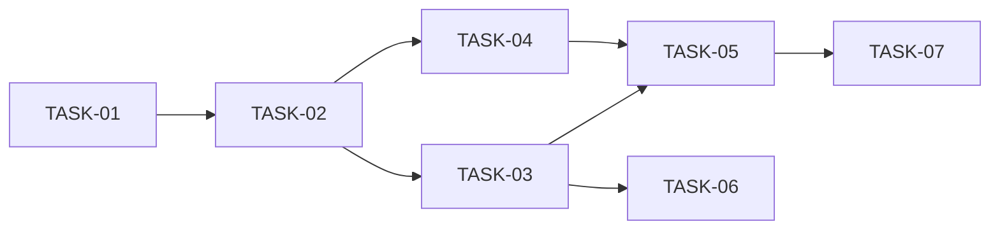

# HU-02: Congelar mi racha · Roadmap de tareas

## Resumen
- **Fuente de verdad:** los TECHNICAL_DOC de `plans/` (no el PRD).
- **Tareas:** 7 (S: 4 · M: 2 · L: 1) · estimación total: 8 h
- **Cobertura:** cada RF del PRD → task(s); cada edge case → task con su test.

## Fases

| Fase | Tareas | Objetivo |
|---|---|---|
| 1 | TASK-01 | Las reglas, puras |
| 2 | TASK-02, TASK-03, TASK-04 | Crear y listar, la racha que se salta los días congelados, cancelar |
| 3 | TASK-05 | La pantalla |
| 4 | TASK-06, TASK-07 | Romperla a propósito y recorrerla en el navegador |

## Dependencias

## Orden de implementación
TASK-01 → TASK-02 → TASK-03 → TASK-04 → TASK-05 → TASK-06 → TASK-07, en serie (comparten `repository.ts`, `schemas.ts` y el servicio). TASK-06 podría ir en paralelo con TASK-05: no comparten ficheros.

## Cobertura PRD → tareas

| RF / CA / EC | Task(s) |
|---|---|
| RF-01 · CA-01, CA-02, CA-03, CA-04 | TASK-01, TASK-02 |
| RF-02 · CA-05, CA-06, CA-10 | TASK-03 |
| RF-03 · CA-07, CA-08 | TASK-01, TASK-04 |
| RF-04 · CA-09 | TASK-05, TASK-07 |
| EC-01 a EC-04 | TASK-01, TASK-02 |
| EC-05, EC-06, EC-14, EC-15 | TASK-06 |
| EC-07 a EC-10 | TASK-03 |
| EC-11, EC-12 | TASK-04 |
| EC-13, EC-16 | TASK-05 (EC-16 también TASK-02) |
| RNF-01, RNF-02 | TASK-03, TASK-06 |
| RNF-03, RNF-04 | TASK-05, TASK-06 |

## Riesgos
- El test de HU-01 que compara la respuesta entera de la racha cambia con `frozenUntil` (TASK-03, previsto).
- Las fechas de los e2e dependen de "hoy" en Madrid: se calculan en el test, no se fijan.
